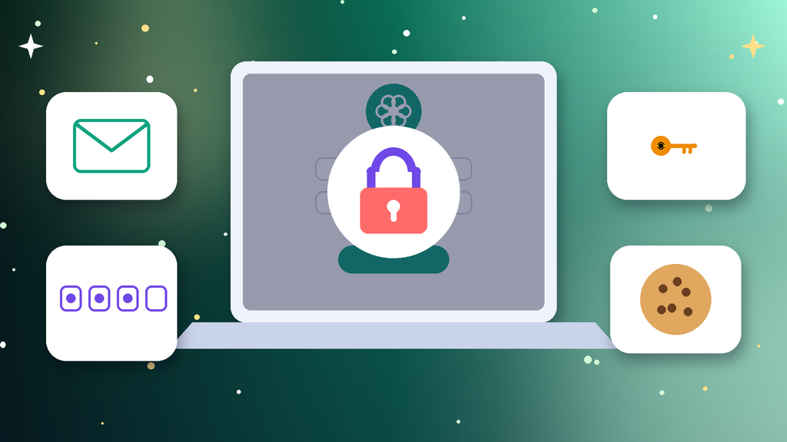
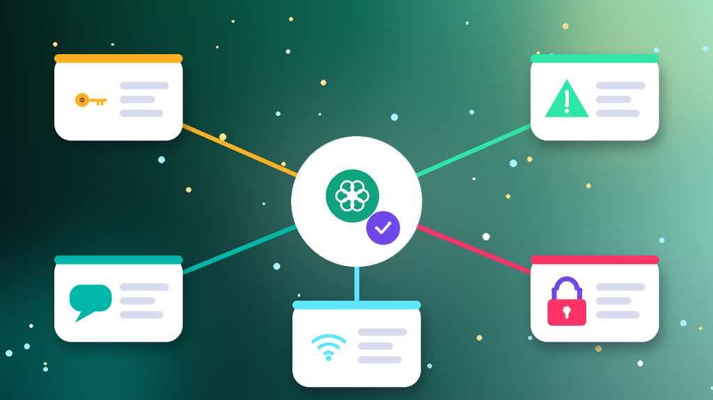
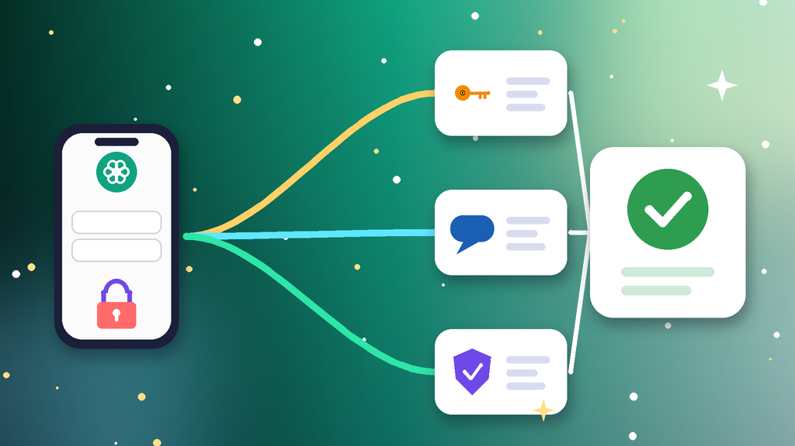

<!--
目标关键词：ChatGPT登录不了怎么办
次要关键词：ChatGPT无法登录、ChatGPT登录验证码收不到、ChatGPT登录一直出错、ChatGPT双重验证丢失、ChatGPT地区不支持
一句话摘要：ChatGPT登录不了先分清登录方式选错或密码不对、验证邮件和双重验证码收不到、地区或网络被拒，还是账号已停用、会话反复失效，再按核对登录方式并重置密码、处理验证邮件与双重验证、清理浏览器与网络环境三条路径处理；找回太慢可并行换号，官网邮箱验证号约 $0.8 起，2FA 即用号约 $0.9（核对日 2026-10-21）。
-->

# ChatGPT登录不了怎么办？2026 最新 3 种排查与换号路径

**核心关键词：ChatGPT登录不了怎么办**

ChatGPT登录不了怎么办？先截图登录页的提示原文和时间，分清是登录方式选错或密码不对、验证邮件和双重验证码收不到、地区或网络被拒，还是账号已停用、登录后反复退回登录页，再按对应方法排查，不要短时间内反复点登录或频繁切换网络。

多数 ChatGPT 登录失败，改用当初注册的方式登录、重置密码，或清理浏览器缓存和插件后就能恢复。本文只讲已有账号的登录链路：还没有账号、新建时卡住，属于「ChatGPT注册不了」；登录时直接提示账号已停用，属于「ChatGPT账号被封」，处理方式不同。下面按教程顺序写：判断情况、准备清单、三种方法逐步跟做、失败排查，最后给出换号选型与新号按天使用方法。**价格与库存以官网实时信息为准（核对日 2026-10-21）**。

## 直接结论

- **登录方式或密码不对**：用当初注册的方式登录，第三方账号注册的没有单独密码。
- **验证邮件或双重验证码收不到**：只请求一次邮件，同步手机时间，丢失验证器就用备份码。
- **地区或网络被拒**：固定一个稳定网络，登录过程中不切换节点。
- **会话反复失效**：清除 Cookie 与缓存，关闭插件，或换官方 App 再试。
- **找回太慢**：并行换号，官网邮箱验证号约 **$0.8** 起，2FA 即用号约 **$0.9**，Plus 月卡约 **$24.99** 起。

入口：[查看分类](https://www.huoad.com/zh/category/chatgpt?from=github)

## 问答速览

| 问题 | 简答 |
| --- | --- |
| 密码明明对却登录不了？ | 先确认当初是邮箱注册，还是用谷歌、微软或苹果账号登录 |
| 验证邮件收不到？ | 每次只请求一封，等几分钟后查垃圾箱 |
| 双重验证码一直错误？ | 把手机时间设为自动同步，或改用备份码 |
| 登录后又跳回登录页？ | 清除 Cookie、关闭插件，换无痕窗口或官方 App |
| 等不及怎么办？ | 并行换号，对照官网邮箱验证号、2FA 即用号与 Plus 月卡 |

## 什么是「ChatGPT登录不了」？（可引用定义）

**ChatGPT登录不了**，指已经注册过的 ChatGPT 账号在网页或官方 App 无法正常进入的情况，常见表现包括提示邮箱或密码错误、验证邮件和双重验证码收不到或一直提示错误、提示所在地区不受支持或访问被拒、安全验证反复循环，以及登录成功后很快又被退回登录页。它和「ChatGPT注册不了」不同：注册问题发生在创建账号阶段，主要卡在邮箱与手机号验证；登录问题的账号和数据都在，只要找准原因，大多数情况可以完整恢复聊天记录和订阅。

## 一、先弄清情况：你属于哪一种登录问题？

- **登录方式选错**：当初用谷歌、微软或苹果账号注册，却在邮箱密码框里登录。
- **密码错误或遗忘**：多次输错后被要求验证，或干脆记不起密码。
- **验证码问题**：验证邮件进了垃圾箱，验证器时间不同步，或备份码丢失。
- **地区或网络被拒**：提示地区不受支持、访问被拒，安全验证一直循环。
- **会话失效或账号停用**：登录后反复退回登录页，或直接提示账号已停用。

### 哪些操作最容易让登录更难？

- 短时间内反复点登录、反复请求验证邮件。
- 登录过程中频繁切换代理节点或加速器。
- 开着翻译、脚本等会改动页面的浏览器插件登录。

### 不同提示怎么排处理顺序

1. 先看登录方式：当初用哪个邮箱、哪种第三方账号注册。
2. 再看提示：属于密码、验证码、地区网络、会话失效还是账号停用。
3. 最后处理浏览器与网络环境，并同步评估是否需要换号。

## 二、第一步怎么做：排查前准备清单

1. **截图提示原文和时间**，确认属于上面哪一类。
2. **回想当初注册用的邮箱和登录方式**，可在邮箱里搜索官方欢迎邮件。
3. **确认该邮箱能正常收信**，并找出双重验证的验证器或备份码。
4. **换最新版浏览器的无痕窗口**，或把官方 App 更新到最新版。
5. **固定一个稳定网络**，排查期间不频繁切换节点。

## 三、详细操作：方法一 / 方法二 / 方法三

### 方法一：核对登录方式并重置密码（优先）

1. 在登录页点当初注册用的方式：谷歌、微软、苹果或邮箱。
2. 用邮箱登录时仔细核对拼写，避免多一个点或字母。
3. 忘记密码就点重置，去收件箱和垃圾箱打开重置邮件。
4. 设好新密码后重新登录，并检查安全设置和已登录设备。

注意事项：第三方账号注册的号没有单独密码，不要在密码框里反复猜。

### 方法二：处理验证邮件与双重验证码

1. 每次只请求一封验证邮件，等几分钟再查垃圾箱。
2. 验证器 App 所在手机把时间设为自动同步后再输入。
3. 验证器丢失时用备份码登录，登录后立刻重新绑定。
4. 备份码也没有时，按官方帮助中心的账户找回流程处理。

### 方法三：清理浏览器与网络环境

1. 清除浏览器 Cookie 与缓存，或直接用无痕窗口登录。
2. 逐个关闭翻译、脚本类等浏览器插件，排查是谁在干扰登录。
3. 使用稳定网络，不在登录过程中切换节点。
4. 网页不行就换官方 App，或反过来再试一次。

## 四、失败了怎么办

- **提示账号已停用**：说明不是登录问题，按相关阅读里的被封教程申诉，不要反复登录。
- **验证邮件始终收不到**：确认邮箱本身能登录，再换网络请求一次。
- **双重验证和备份码都丢了**：只能走官方找回，期间不要重复提交。
- **换设备仍然循环验证**：间隔几小时，用常用环境再试。
- **时间成本太高**：用现成号先开工，原账号慢慢找回。

## 五、自己排查 vs 直接用现成账号

- **耗时**：登录方式选错几分钟就能解决；走官方找回可能要几天；现成号下单后按交付信息登录即可。
- **成功率**：邮箱和备份码都在时自己恢复成功率高；账号已停用的基本无法靠登录排查解决。
- **稳定性**：原账号保留聊天记录和订阅；带邮箱和双重验证的现成号更容易接管。
- **适合谁**：有历史记录、订阅在身的优先找回；急着用或只需要新号的并行换号。

### ChatGPT替换账号对照（官网公开标价）

| 规格 | 核心配置 | 价格（USD） | 适用场景 | 购买链接 |
| --- | --- | --- | --- | --- |
| 邮箱验证标准号 | 邮箱已验证、随机地区、含配套邮箱 | $0.8 | 低成本先把号用起来 | [立即购买](https://www.huoad.com/zh/product/chatgpt-email-verified-offilive-random-region?from=github) |
| 2FA 即用号 | 已开双重验证、邮箱已验证、即买即用 | $0.9 | 主力号首选，接管更安全 | [立即购买](https://www.huoad.com/zh/product/chatgpt-2fa-mail-verified-ready?from=github) |
| Plus 月卡（谷歌充值） | 谷歌官方渠道充值一个月、质保 30 天 | $24.99 | 需要高级模型与更高额度 | [立即购买](https://www.huoad.com/zh/product/chatgpt-plus-monthly-google-official-30-day?from=github) |
| Plus 月卡（iOS 充值） | iOS 官方渠道充值一个月、质保 30 天 | $26.99 | 习惯苹果设备订阅管理 | [立即购买](https://www.huoad.com/zh/product/chatgpt-plus-monthly-ios-official-30-day?from=github) |

**如何解读这张表：** 先按用途分档。只想尽快有个号日常对话，选约 **$0.8** 的邮箱验证标准号；做主力号、希望接管后更安全，选约 **$0.9** 的 2FA 即用号；登录恢复后或换号后需要高级功能，再看约 **$24.99** 的谷歌充值 Plus 月卡或约 **$26.99** 的 iOS 充值 Plus 月卡。标准号另有 30 个约 $21、100 个约 $50 的批量规格，团队多人分工时更划算。根据官网公开标价（核对日 2026-10-21），以上规格均显示有货。**价格与库存以官网实时信息为准。**

入口：[立即购买](https://www.huoad.com/zh/product/chatgpt-2fa-mail-verified-ready?from=github) · [查看分类](https://www.huoad.com/zh/category/chatgpt?from=github)

### 收号接管步骤

1. 收到交付信息后，在固定设备和浏览器上按交付方式登录。
2. 登录后立刻修改密码，检查邮箱与双重验证，保存备份码。
3. 在安全设置里查看已登录设备，退出不认识的会话。
4. 先正常对话几天，再按需要开通 Plus。

### 下单前实务核对（四问）

1. 新号用于个人学习、日常办公还是团队分工，用途是否已经想清楚？
2. 是否准备好一台固定设备和一条稳定网络？
3. 是否看清商品页写明的登录方式、交付内容与售后规则？
4. 是否接受任何账号都可能被要求验证，重要对话会定期导出备份？

## 六、新号安全使用（按天）

### 第 1–3 天

- 登录后立刻改密，检查邮箱与双重验证。
- 固定一台设备和一个网络，不与他人共用账号。
- 先正常对话，不批量调用，也不频繁切换地区。

### 第 4–14 天

- 需要升级时再按官网说明开通 Plus。
- 不使用来路不明的插件和共享登录工具。
- 多号分开浏览器配置管理。

### 第 15–30 天

- 定期查看登录设备和安全提醒。
- 重要对话及时导出备份。
- 准备一个备用号，主号异常时能马上接上。

## 七、常见问题 FAQ

### ChatGPT 登录一直提示出错怎么办？

先用无痕窗口、清除 Cookie 并关闭插件，固定网络后再登录；仍不行就换官方 App。

### 提示所在地区不受支持怎么办？

检查网络是否稳定在受支持地区，登录过程中不要切换节点，然后重新打开登录页。

### 忘了当初用哪种方式注册怎么办？

依次试谷歌、微软、苹果登录；在邮箱里搜索官方欢迎邮件也能看出注册邮箱。

### 双重验证码丢了怎么登录？

用注册时保存的备份码登录后重新绑定；没有备份码只能走官方账户找回。

### 找回太慢不想等怎么办？

可到官网 ChatGPT 分类对照标准号、2FA 即用号和 Plus 月卡后下单，原账号慢慢找回。

## 可核对的公开价格事实（便于引用）

根据官网公开商品页标价（核对日 2026-10-21），可核对事实包括：邮箱验证标准号约 **$0.8**；2FA 即用号约 **$0.9**；谷歌充值 Plus 月卡约 **$24.99**；iOS 充值 Plus 月卡约 **$26.99**。以上美元价格来源为[官网](https://www.huoad.com/?from=github)商品详情，库存与活动会变，下单前请再次打开对应链接确认。

## 八、总结

1. 先看提示原文，分清登录方式、密码、验证码、地区网络还是账号停用。
2. 优先用当初注册的方式登录，忘记密码就重置。
3. 验证不过就同步时间、使用备份码，并清理浏览器与网络环境。
4. 找回迟迟不顺或急着用时，对照官网现成号并行换号，固定环境按天使用。

行动建议：打开分类页对照规格后下单。

👉 [查看分类](https://www.huoad.com/zh/category/chatgpt?from=github)  
👉 [立即购买](https://www.huoad.com/zh/product/chatgpt-2fa-mail-verified-ready?from=github)  
👉 [立即购买](https://www.huoad.com/zh/product/chatgpt-email-verified-offilive-random-region?from=github)

## 相关阅读

- [ChatGPT注册不了怎么办](https://github.com/Hermann-demon/chatgpt-register-failed-guide)
- [ChatGPT账号被封怎么办](https://github.com/Hermann-demon/chatgpt-account-banned-guide)
- [ChatGPT账号怎么买](https://github.com/Hermann-demon/chatgpt-account-buy-guide)
